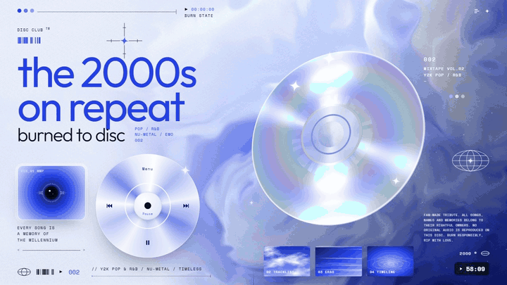

# Disc Club — the 2000s on repeat

A Y2K tribute to the music of the 2000s, laid out like a CD sleeve: an iridescent disc spinning in Three.js, an iPod click wheel that actually plays, and a decade of songs, scenes and milestones burned to one page.

[**View the live project**](https://wqryx.github.io/disc-club/) · [**View the source**](https://github.com/wqryx/disc-club)



## What it does

- Opens on a full-screen cover in icy blue: a 3D CD with a moving rainbow sheen floats over a silky shader sky, framed by HUD details such as a running timecode, barcodes, a wireframe globe, sparkles and three sky thumbnails that link into the page.
- Turns the classic disc into an iPod click wheel: the centre button plays and pauses, the arrows skip tracks, Menu jumps to the tracklist, and dragging around the ring changes the volume.
- Replaces the cover's eye with an iris drawn by a Windows Media Player-style visualizer that reacts to the sound as it plays.
- Lists fifteen songs of the decade, from *Crazy in Love* to *Mr. Brightside*, with a now-playing card, a spinning CD and a YouTube search link for each track.
- Walks through eight scenes of the decade (pop princesses, R&B and crunk, nu-metal, emo and pop-punk, indie revival, trance, reggaetón and UK garage), a 2000–2009 timeline and the formats that defined it: 128 kbps, 1,000 songs, 74 minutes and the 30-second ringtone.
- Synthesises a different ambient track for each song in the browser: pads, plucks, bass and a soft beat. No original recordings are played.
- Adapts to phones with a stacked hero layout and respects reduced-motion settings.

## How it is made

Disc Club is a deliberately small static site. `index.html` contains the markup, CSS, copy, track data, sound engine, visualizer and Three.js scene. There is no build step, package manager or framework.

Nothing on the page is a downloaded image or model. The sky behind the disc is a full-screen domain-warped noise shader with silk-like strands, faded into the paper colour on the left so the type stays readable. The CD is a single circle mesh whose fragment shader draws the clear hub, the data ring, the grooves and an anisotropic highlight that stays fixed while the disc tilts, so it catches the light like a real CD. A sparkle is pinned to that highlight every frame. The click wheel and the smaller CDs are CSS conic gradients, and the sky thumbnails are SVG turbulence filters.

The sound comes from a small Web Audio sequencer. Each track picks its own key, tempo and chord progression, and the analyser behind it drives the iris visualizer.

## Run locally

From the repository root, run:

```bash
python3 -m http.server 4173 --bind 127.0.0.1
```

Then visit [http://127.0.0.1:4173/](http://127.0.0.1:4173/).

Python is only used to serve the static files; any static server works. The page loads Three.js r160 from unpkg and its typefaces from Google Fonts, so it needs a network connection.

## Project structure

```text
disc-club/
├── index.html            # the whole site: markup, styles, data, sound and 3D scene
├── icon.svg              # favicon
├── apple-touch-icon.png  # home-screen icon, 180 × 180
├── og.png                # share card, 1200 × 630, rendered from the live page
├── assets/
│   └── disc-club.gif
└── README.md
```

## Design and attribution

Disc Club is an original, independent design study inspired by the look of a Y2K-style "music heals the soul" cover seen on YouTube. It is a fan-made tribute and is not affiliated with any artist, label or company named on the page.

Song titles, artists, years and durations are commonly cited figures, and timeline entries are rounded to the year. Three.js is © three.js authors and used under the MIT license; the typefaces are Outfit and Space Mono, served by Google Fonts under the SIL Open Font License.

## En español

Disc Club es un homenaje a la música de los 2000 con estética Y2K de portada de CD: un disco iridiscente en 3D que gira sobre un cielo azul sedoso, y una rueda de iPod que funciona de verdad para reproducir, saltar canciones y cambiar el volumen. La página recorre quince canciones míticas de la década, ocho escenas musicales (del pop al reggaetón), una línea de tiempo de 2000 a 2009 y los formatos de la época. El sonido es ambiental y se genera en el propio navegador, con una pista distinta para cada canción, así que no se reproduce ninguna grabación original.

[**Ver la web**](https://wqryx.github.io/disc-club/)

## License

No license is currently granted for reuse or redistribution of the original Disc Club code or share artwork. Three.js and the fonts remain covered by their own licenses.
